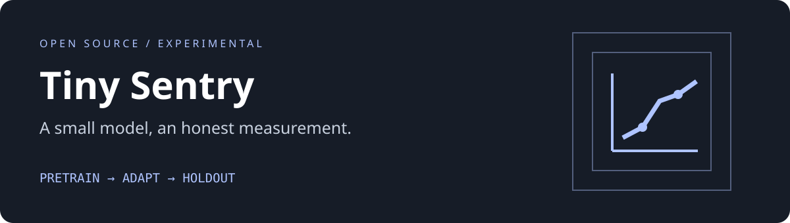

# Tiny Sentry

A reproducible CPU-only adaptation experiment for prompt-injection text classification.

 



Tiny Sentry pretrains a 1,025-parameter logistic model on a synthetic social-engineering task, then fine-tunes the same weights on prompt-injection examples. A scratch-trained control keeps the comparison honest. This is a small-model fine-tune, **not an LLM**, not a nanochat clone, and not a security filter you should rely on.

## Features

- Pure Python standard library: zero model downloads or GPU requirements
- Stable SHA-256 feature hashing for unigrams and bigrams
- Separate pretrain, fine-tune and template-disjoint test sets
- Reproducible checkpoints, input hashes, confusion matrices and error examples
- Base versus fine-tuned versus scratch comparison
- [Model card](MODEL_CARD.md) and [measured evaluation report](EVAL_REPORT.md)

## Quickstart

Python 3.10+.

```sh
python3 -m unittest -v
python3 sentry.py train
python3 sentry.py classify 'Summarize the public status report'
```

Training takes seconds on an ordinary CPU. It writes `artifacts/base.json`, `model.json` and `report.json`; checked-in artifacts are from the supplied seed 41 and 90 epochs per stage. Re-running overwrites them deterministically. There are no hidden service calls.

## Architecture

```text
text -> word/bigram hashes -> L2 normalization -> 1024 weights + bias
                    pretrain checkpoint -> continued SGD -> classifier
```

Stable feature hashes avoid Python's randomized hash seed. The model applies binary cross-entropy SGD, active-feature-only L2 weight decay and a fixed 0.5 threshold. `data/` uses split-specific template groups and names. All texts are original synthetic examples; examples about attacks are data and are never executed.

## Measured results

On 12 effective template examples expanded into 48 synthetic test rows (24 per class), base accuracy is 75.0%, adapted accuracy is 75.0%, and scratch accuracy is 70.8%. Adaptation raises recall from 66.7% to 83.3%, but doubles false positives from 4 to 8. It does **not** improve accuracy. These 48 rows come from only 12 templates, so they are not 48 independent examples.

## Limitations

Lexical features miss context and obfuscated attacks. Scores are not calibrated probabilities. The dataset is tiny, English-only and synthetic. Legitimate discussion of attacks can be flagged, and unfamiliar attacks can be missed. No production blocking, authorization or trust decisions should depend on this model.

## Roadmap

- Independent human-authored holdout and paraphrase stress tests
- Validation-only threshold selection and calibration study
- Optional tiny neural encoder with compute-matched baselines

## Inspiration

Inspired by the small, readable, reproducible training philosophy of [nanochat](https://github.com/karpathy/nanochat). No source or pretrained weights were reused. The system-font SVG banner is original and MIT licensed.

## Contributing

Read [CONTRIBUTING.md](CONTRIBUTING.md). Code and original artwork are [MIT licensed](LICENSE).
